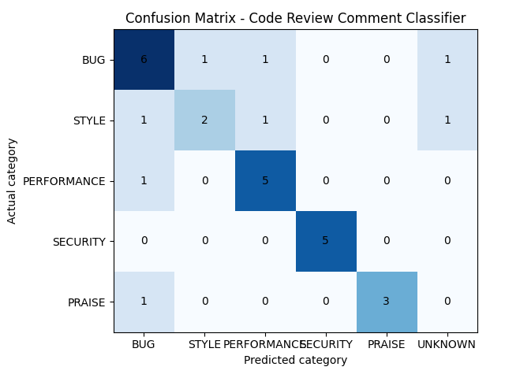
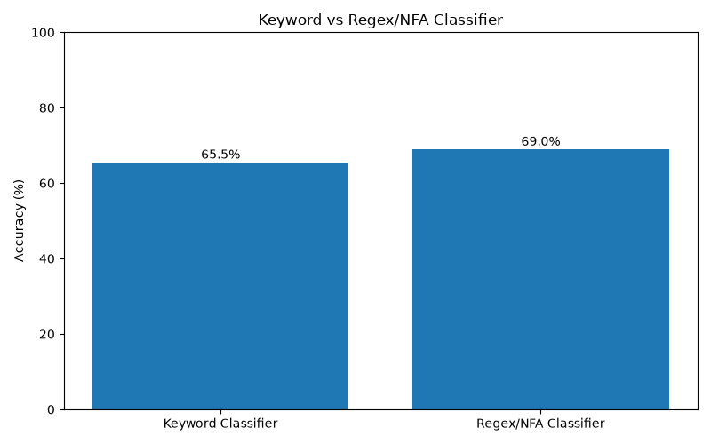

# Code Review Comment Classifier

Classifies GitHub code-review comments into **BUG, STYLE, PERFORMANCE, SECURITY, PRAISE** using one set of regular expressions per category, combined into a single NFA-style machine. Theory of Computation project (Regex / NFA text classification).

AI review tools can use this as a cheap pre-processing step: flag security comments as urgent, skip praise, and only send the rest to an AI model.

## Files

| File | Purpose |
|---|---|
| `classifier.py` | Regex/NFA classifier and accuracy report |
| `keyword_classifier.py` | Simple keyword baseline |
| `compare.py` | Baseline vs regex chart (`comparison_graph.png`) |
| `confusion_chart.py` | Confusion matrix chart (`confusion_matrix.png`) |
| `comments.csv` | 30 hand-labelled GitHub review comments |

## Run

```
pip install matplotlib numpy
python classifier.py comments.csv
python compare.py
python confusion_chart.py
```

Options: `--comment-col NAME`, `--label-col NAME`, `--no-matrix`.

`comments.csv` is tab-separated with columns `id, comment, label, source_url`. Only `comment` is required. With a `label` column, the accuracy report, per-category precision/recall and confusion matrix are printed.

## How it works

Every regex is equivalent to an NFA, and the union of NFAs is an NFA, so all patterns are joined into one machine. A comment is accepted if at least one pattern matches. Patterns use word boundaries and word variations, for example `crash(es|ed|ing)?`.

**Tie-breaking:**
1. The category with the most distinct matched patterns wins.
2. Ties go by priority: SECURITY > BUG > PERFORMANCE > STYLE > PRAISE.
3. No match gives `UNKNOWN`.

## Results (30 comments, labelled by hand)

| Classifier | Accuracy |
|---|---|
| Keyword baseline | 66.7% |
| **Regex/NFA** | **70.0%** |

| Category | Precision | Recall |
|---|---|---|
| BUG | 0.60 | 0.67 |
| STYLE | 0.67 | 0.40 |
| PERFORMANCE | 0.71 | 0.83 |
| SECURITY | 1.00 | 1.00 |
| PRAISE | 1.00 | 0.60 |




## Limitations

- Only 30 comments, and the patterns were refined on the same data, so the accuracy is optimistic.
- Words like `cache`, `regression` and `failing` appear in several categories, and design comments with no keywords end up as `UNKNOWN`.
- A few comments come from PR descriptions or author replies, not inline reviews.
